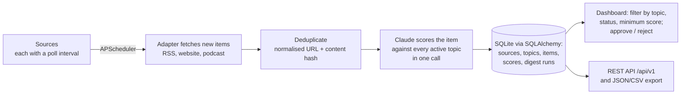

# Content aggregator

Collects new items from sources you choose (RSS feeds, websites, podcasts), removes duplicates, and asks Claude
how relevant each item is to each of your topics. A dashboard lists items with their scores so you can approve or
reject them, and approved items can be exported as JSON or CSV.

*This README was written from the code; the project was built in an earlier session and is an early version (v1
scaffold, issue #5).*

## How it works



| Path | Purpose |
|---|---|
| `src/aggregator/main.py` | FastAPI app: dashboard, sources and topics pages; starts the database and scheduler |
| `src/aggregator/api/` | REST API under `/api/v1`: `sources` (CRUD and "fetch now"), `topics` (CRUD), `items` (list, curate, export JSON/CSV) |
| `src/aggregator/ingestion/` | Source adapters: `RSSAdapter` (also used for websites) and `PodcastAdapter` |
| `src/aggregator/pipeline/` | `runner.py` (fetch, deduplicate, store, score), `deduplicator.py`, `scorer.py` (Claude, default `claude-sonnet-4-6`, cached system prompt, JSON reply) |
| `src/aggregator/scheduler/` | One job per active source at its poll interval; the job list is refreshed every 10 minutes |
| `src/aggregator/models/` | `Source`, `Topic`, `Item` (with curation status), `Score`, `DigestRun` |
| `src/aggregator/ui/templates/` | Dashboard, sources and topics pages |
| `alembic/` | Database migrations (none written yet; tables are created on start) |

## Run it

```bash
cd content-aggregator
python -m venv .venv && . .venv/bin/activate
pip install -e ".[dev]"
cp .env.example .env      # ANTHROPIC_API_KEY is required; the rest only for the sources you use
uvicorn aggregator.main:app --reload --app-dir src     # http://localhost:8000
```

Add topics (a name and a description of what counts as relevant), then sources, from the pages in the app.

## Known issues (checked 15 Nov 2026)

As written, the app does not start with the versions `pip install` picks today:

- `pyproject.toml` asks for APScheduler 4 (`apscheduler>=4.0.0a5`), but `scheduler/jobs.py` uses the APScheduler 3 API
  (`apscheduler.schedulers.asyncio`), so start-up fails with `ModuleNotFoundError`. Fix: pin `apscheduler>=3.10,<4`.
- SQLAlchemy's async engine needs `greenlet`, which is not listed. Fix: depend on `sqlalchemy[asyncio]`.
- With both fixed, the REST API works (`GET /api/v1/topics/` returns 200), but the HTML pages return 500: `main.py` calls
  `templates.TemplateResponse("page.html", {"request": request, ...})`, the old argument order, which current
  Starlette rejects (`TypeError: unhashable type: 'dict'`). Fix: `TemplateResponse(request, "page.html", {...})`.

## Not built yet

- Adapters for Reddit, X/Twitter, YouTube and email newsletters: the source types, settings and libraries exist,
  but fetching from them is not wired up, so those sources are skipped.
- Digests: the email and Slack settings and the `DigestRun` table exist, but nothing sends a digest yet
  (`digest_model` defaults to `claude-opus-4-6` for when it does).
- Tests: the `tests/` folders are empty.
