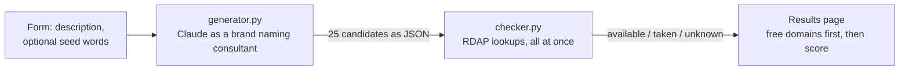

# Domain finder

Describe a startup in a sentence and get 25 name ideas, each with a tagline, the story behind it, how to say it, the
naming technique used and a score, sorted so names with a free domain come first. For each name it checks `.ai`,
`.io` and `.co`, and links to GoDaddy and Namecheap to buy one.

*This README was written from the code; the project was built in an earlier session.*

## How it works



| File | Purpose |
|---|---|
| `main.py` | FastAPI app: `GET /` shows the form, `POST /check` generates and checks names. Optional HTTP Basic password |
| `generator.py` | Asks Claude (default `claude-sonnet-4-6`) to work through a structured naming process (brief, five naming techniques, filtering) and return 25 candidates as JSON |
| `checker.py` | Checks each name on each TLD through RDAP: 404 means available, 200 taken, anything else unknown. No API key needed |
| `templates/index.html` | The page |

## Run it

```bash
cd domain-finder
python -m venv .venv && . .venv/bin/activate
pip install -e .
cp .env.example .env          # add ANTHROPIC_API_KEY; set APP_PASSWORD if the app will be reachable by others
uvicorn main:app --reload     # http://localhost:8000
```

| Setting | Meaning |
|---|---|
| `ANTHROPIC_API_KEY` | Required |
| `APP_PASSWORD` | When set, the browser's login box must be given this password (any user name). When unset, the login box still appears and anything is accepted |
| `MODEL` | Claude model for name generation; defaults to `claude-sonnet-4-6` |

## Known issues (checked 15 Nov 2026)

- **Pages fail with current FastAPI.** `main.py` calls `templates.TemplateResponse("index.html", {"request": request, ...})`,
  the old argument order. With the FastAPI/Starlette versions `pip install` picks today, that raises
  `TypeError: unhashable type: 'dict'` and every page returns 500. Fix: `TemplateResponse(request, "index.html", {...})`,
  or pin an older Starlette.
- **The login box always appears**, because the HTTP Basic check runs even without `APP_PASSWORD`.

## Limits

- RDAP "not found" is a strong hint, not a guarantee; check with a registrar before buying.
- There are no tests.
