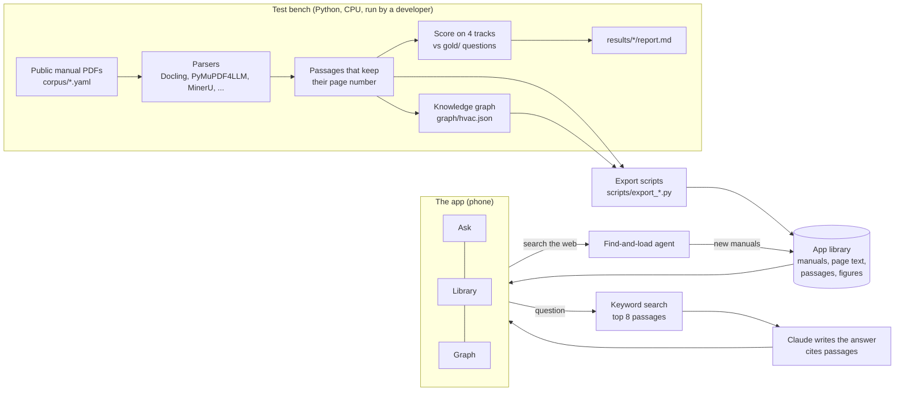
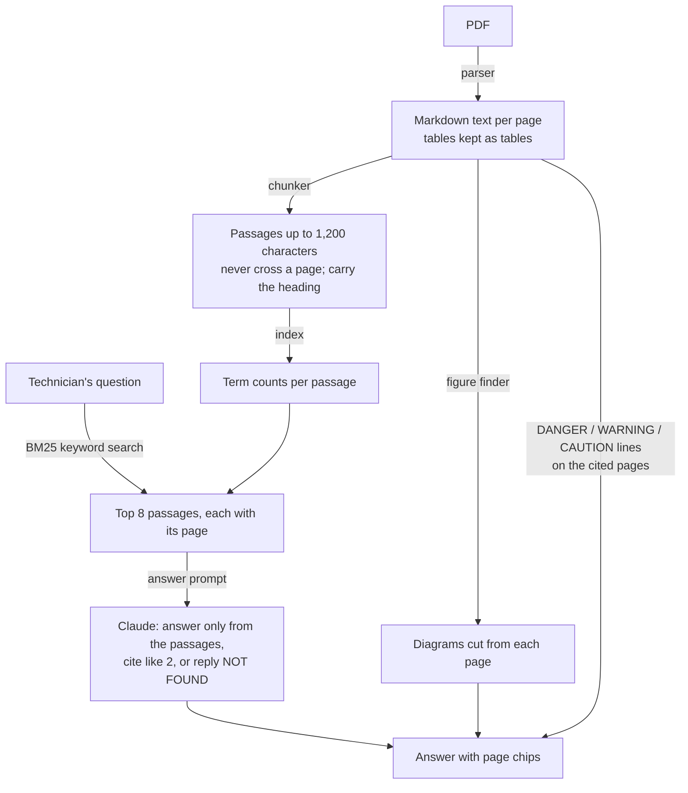
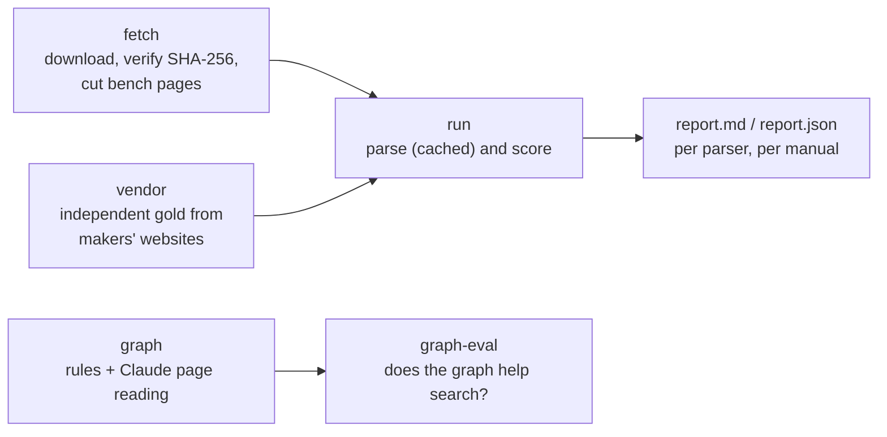
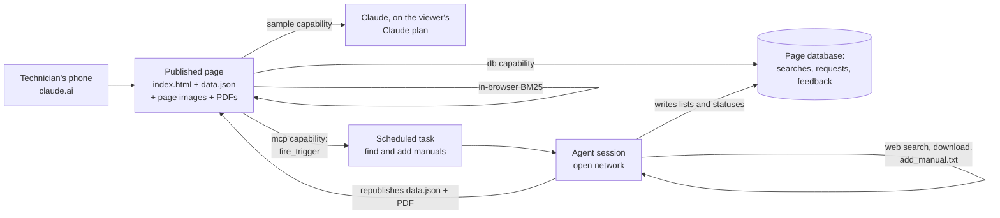
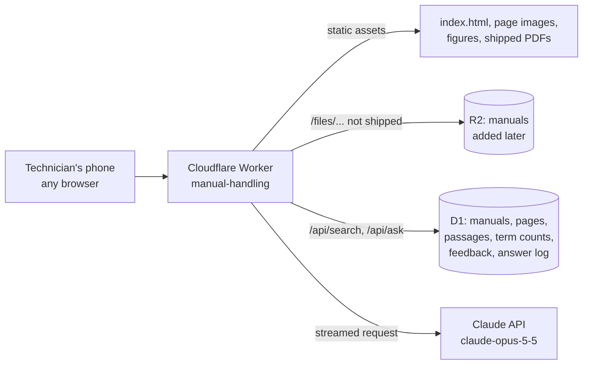

# Manual Handling: architecture

**In plain words.** Manual Handling turns equipment manuals (PDFs) into something a technician can ask on a phone:
"what torque for the coupling capscrews?" gets an answer written only from the manual, with a link to the printed
page that proves it, the diagram from that page, and any safety warning printed there. If the manual doesn't say,
the app says "not found" instead of guessing.

The system has three parts:

1. **The test bench** (Python, this folder) decides *how* to read manuals: it tries several PDF readers ("parsers"),
   search methods and answer prompts, and scores them against hand-checked questions and answers.
2. **The app** is what technicians use. It exists in two versions: the original runs as a published page on
   claude.ai, and a newer one runs on Cloudflare as an ordinary website.
3. **The library tools** add manuals: export scripts turn bench output into the app's library, and an agent can find
   new manuals on makers' websites and load them.

For the detail behind each part (database tables, search scoring, API, limits, safety checks) see
[TECHNICAL_DESIGN.md](TECHNICAL_DESIGN.md).

## The system on one page

## How a manual becomes an answer

Choices behind this pipeline, all measured on the bench:

| Step | Choice | Why |
|---|---|---|
| Parser | Docling for the bench library; PyMuPDF4LLM for manuals added from the web | Docling scored best on manuals (80.5 overall, keeps large torque tables) but needs PyTorch; PyMuPDF4LLM is fast and light enough to run in a short-lived agent |
| Passages | Up to 1,200 characters, never crossing a page | Every passage can be cited to one page |
| Search in the app | BM25 keyword search, top 8 passages | Matched the bench's heavier reranked search closely at this size (94.4% vs the bench's reranked 136/145); runs anywhere with no model |
| Answering | Claude with the bench's answer prompt | 94.4% correct with a manual picked, 29/29 "not found" on unanswerable questions |
| Grading (bench only) | Jev first, Claude when Jev is unsure | Agreed with Claude on 140 of 141 grades at a fraction of the cost |

## The bench

The bench is a command-line tool, `python -m manual_app`, run by a developer. It never serves users.

| Track | Measures |
|---|---|
| A. Parse fidelity | Text similarity and table structure (TEDS) against hand-transcribed pages |
| B. Rule tests | Pass/fail checks: clauses verbatim, table cells, step order, headings, part numbers |
| C. Extraction | Every WARNING/CAUTION/NOTE found, rule-based and with Claude |
| D. Retrieval and answers | Whether search finds the evidence page, answer accuracy, citations, "not found" when it should |

Claude can run three ways for the bench's LLM steps: the Claude API (default when a key is set), Amazon Bedrock in
Sydney, or **session mode**, where tasks are queued to a file and answered inside a Claude Code session on a
Claude subscription (no API key). Every Claude answer in `results/` so far was produced in session mode.

## The app: two versions

Both versions share one page design (`web/app/index.html` for claude.ai, `cloudflare/public/index.html` for
Cloudflare): three tabs (Ask, Library, Graph), a page reader, and the same search and answer prompt.

### Version 1: published page on claude.ai

- **No server, no API key.** The whole library (`data.json`, about 1.9 MB) loads into the phone, search runs in the
  browser, and Claude answers on the viewer's own Claude plan.
- **Finding manuals.** The Library's search box saves a search in the page's database and starts a scheduled task
  ("Manual Handling: find and add manuals") through the viewer's Claude Code connector. The task starts an agent
  session that searches makers' websites, writes a de-duplicated list back, and, for manuals the person ticks,
  downloads, checks and parses them with `tools/add_manual.txt`, then republishes the page with the new manual.
  The task also runs every six hours as a fallback.
- **Limits.** A published page holds at most 511 files; the library uses about 507. Every phone downloads the whole
  library.

Links: [app](https://claude.ai/artifact/UqdGdemFnqzJKH11KSRZbn),
[landing site](https://claude.ai/artifact/7es1xaThKN1kSoaw7mkEnu),
[film](https://claude.ai/artifact/NstU82VVfc9Fq3DhCpMLF8),
[workbench](https://claude.ai/artifact/QbUbwe44Vzcismk1YhUnLk),
[bench dashboard](https://claude.ai/artifact/A5oyCHSE74MgyTpduyiA5B). Published pages are private until shared.

### Version 2: Cloudflare (built, not yet deployed)

- **A normal public website.** No sign-in, so written answers are rate limited per device and per day.
- **Search moved to the database.** The browser's BM25 now runs over term counts stored in D1, with the scoring
  arithmetic done in the Worker; on all 201 test questions in both scopes it returns the same passages as the
  browser version (402 of 402).
- **Answers stream** from the Claude API to the phone as they are written.
- **Not ported yet:** finding and loading manuals from the web. Parsing PDFs needs Python, which a Worker cannot run,
  so that step will need a Cloudflare Container or the existing agent calling an admin endpoint.

Deployment steps: [`cloudflare/DEPLOY.md`](../cloudflare/DEPLOY.md).

## Other pages

| Page | Source | What it is |
|---|---|---|
| Workbench | `web/workbench/` | For developers: each page beside its parsed text, every test question with Claude's answer and grade, and a form to add new labelled questions |
| Landing site | `web/landing/` | The film as the front page, then how it works, the app, proof and "your manuals", phone first |
| Film | `film/`, `web/film/` | A 2 min 26 s film rendered from a three.js page with generated music and ElevenLabs narration |
| Bench dashboard | (claude.ai only) | Charts of the bench results |

## Where data lives

| Data | Where | In git? |
|---|---|---|
| Source PDFs, parser outputs, LLM task queue | `data/` (234 MB) | No: re-created by `fetch` and `run` |
| Hand-checked questions and answers | `gold/` | Yes |
| Bench results | `results/<date>-<corpus>-<setting>/` | Yes |
| Knowledge graph | `graph/hvac.json` | Yes |
| claude.ai app library | The published page's files; searches, requests and feedback in its page database | No: lives on claude.ai |
| Cloudflare app library | `cloudflare/seed/data.json` (loaded into D1), `cloudflare/public/files/` | Yes |

## Main decisions and trade-offs

| Decision | Chosen | Alternatives | Trade-off |
|---|---|---|---|
| Parser | Docling | PyMuPDF4LLM, MinerU, LiteParse, hosted parsers | Best tables, MIT licence; slow on CPU (4.7 s a page) and needs PyTorch |
| App search | BM25 keyword | Hybrid with embeddings and a reranker (the bench's best) | Slightly weaker at scale, but no model to host; meaning-based search (Vectorize) is the planned addition |
| First app host | claude.ai published page | A hosted web app | Free and no keys, but private sharing only, a file cap and whole-library downloads |
| Second app host | Cloudflare Workers + D1 + R2 | Vercel + Neon/RDS + S3 | One vendor and the user's existing practice; D1 is SQLite (no pgvector), so meaning-based search would use Vectorize |
| Adding manuals | Agent on a scheduled task | A hosted search API and backend | No server to run and copes with odd maker sites; takes about a minute per search |
| Data residency | Not required for now | Bedrock in Sydney | The bench can still run onshore via Bedrock if that changes |
| Sign-in | None, public manuals only | Email links, accounts | Simple; answer cost is bounded by rate limits instead |

## Known limits

- **Small test set.** Twelve bench manuals and 208 test questions; differences of a few points are noise.
- **Grades are unchecked by a person.** The answerer and grader are the same model family.
- **Manuals added from the web** are parsed with a lighter parser than the one the accuracy was measured with, and
  scanned PDFs without text are refused.
- **Safety checks** catch obvious prompt-injection wording in loaded manuals, not a manual that is simply wrong. See
  the security section of the technical design.
