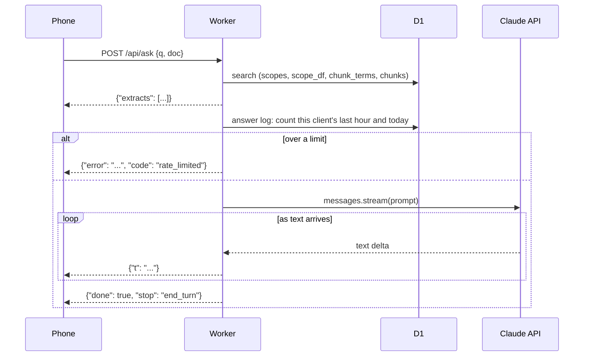
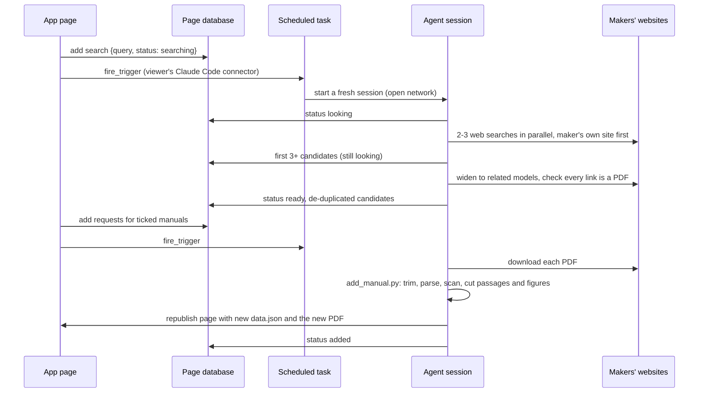

# Manual Handling: technical design

The detail behind [ARCHITECTURE.md](ARCHITECTURE.md): how passages are made and searched, what Claude is asked,
the data model and API of the Cloudflare version, how manuals are added from the web, and the safety and cost
controls. Paths are relative to `manual-app/`.

## 1. Code map

| Path | Language | Purpose |
|---|---|---|
| `manual_app/` | Python 3.11+ | The bench: `cli.py` (commands), `corpus.py` (download and verify PDFs), `parsers/` (one adapter per parser, plus `router.py` for per-page routing), `retrieve.py` (passages, BM25, dense, hybrid, reranker, answer prompt), `extract.py` (safety notices), `llm.py` (Claude client), `judge.py` (graders), `graph.py` (knowledge graph), `metrics/` (text, TEDS, rules, retrieval), `report.py`, `vendor.py`, `validate_gold.py` |
| `scripts/` | Python | Exports for the pages (`export_workbench.py`, `export_app.py`, `export_figures.py`, `export_app_graph.py`), adding a manual (`add_manual.py`, `bundle_add_manual.py`), the app accuracy test (`eval_app.py`), session-mode helper (`session_tool.py`), grader spot check (`spot_check.py`), setup and run-all shell scripts |
| `corpus/` | YAML | Manuals to fetch: URL, SHA-256, pages used |
| `gold/` | JSONL, Markdown | Hand-checked page transcriptions, tables, rule checks, safety notices and questions per manual |
| `results/` | Markdown, JSON | One folder per bench run |
| `graph/` | JSON | The HVAC knowledge graph |
| `web/app/`, `web/workbench/`, `web/landing/`, `web/film/` | HTML + JS | Pages published on claude.ai |
| `cloudflare/` | JS, SQL | The Cloudflare version: Worker (`src/`), D1 schema (`migrations/`), seed builder and parity check (`scripts/`), library (`seed/data.json`), static files (`public/`) |
| `film/` | HTML, JS, shell | The film: scene, music, narration, renderer, encoder |
| `tests/` | Python, JS | `test_metrics.py` (pytest) and `browser/` (Playwright checks) |
| `notes/` | Markdown | Research notes |

`metrics/requirements.py` scores tender requirement extraction, left from the project's first focus on tenders;
no current corpus uses it.

## 2. From PDF to passages

**Parsing.** Each parser adapter returns Markdown per page (`ParseResult`), cached under `data/outputs/<parser>/`.
Offshore parsers are skipped unless `--allow-offshore`. Docling runs with TableFormer and RapidOCR.

**Passages** (`retrieve.chunk_pages`). Page Markdown is split on blank lines. A Markdown heading starts a new passage
and becomes the heading of the passages after it. Blocks are added to a passage until it would pass 1,200
characters; a single longer block is cut into 1,200-character pieces overlapping by 150. A passage never crosses
a page, so every passage has exactly one page to cite.

**Figures** (`scripts/export_figures.py`, no model). On each page, embedded images and clusters of vector drawing
are merged into regions. Regions narrower than 20% of the page or shorter than 9% are dropped (logos, rules), as
are those over 80% of the page (backgrounds, scans) and dense text boxes (more than 45 words at more than 0.0009
words per square point, which are tables already in the text). Up to four per page are kept, as JPEGs for bench
manuals or as crop rectangles over the PDF for manuals added from the web.

## 3. Search

### In the bench

Five strategies (`retrieve.search`): `bm25`; `dense` (BGE-small embeddings); `hybrid` (reciprocal rank fusion of the
two, k = 60); `hybrid-ctx` (each passage prefixed with the manual title and heading); `hybrid-rerank` (the top 30
of hybrid-ctx re-scored by the `ms-marco-MiniLM-L-6-v2` cross-encoder). The answer step uses `hybrid-rerank` and
the top 5 passages.

### In the app (both versions)

BM25 over the top 8 passages, defined by the original browser code:

- **Tokens:** lower-cased text matched by `[a-z0-9]+(?:[.%][0-9]+)?`, so `3.5`, `12%` and `r410a` stay whole.
- **Indexed text per passage:** `"<manual title> | <heading> | <passage text>"`.
- **Scope:** one manual, or the whole library. IDF, passage count and average length are computed over the scope
  searched, so the same question can rank differently in the two scopes.
- **Score:** for each distinct query term t in question order,
  `idf(t) × tf × (k1 + 1) / (tf + k1 × (1 − b + b × len / avg))`, with k1 = 1.5, b = 0.75 and
  `idf(t) = max(0.05, ln((N − df + 0.5) / (df + 0.5)))`, summed per passage.
- **Order:** score descending; ties keep library order (manual order, then passage order).

**Cloudflare implementation** (`cloudflare/src/search.js`). The database stores the counts and the Worker does the
arithmetic, so results are identical to the browser's:

1. Read N and total length for the scope from `scopes`.
2. In one D1 batch, per group of up to 90 query terms (D1 allows 100 bound parameters): `df` from `scope_df` and the
   matching `(chunk_id, term, tf, len)` rows from `chunk_terms`, filtered to the manual when one is picked.
3. Score in JavaScript exactly as above, sort, take 8, then read those passages from `chunks`.

`cloudflare/scripts/check_search.mjs` runs the original browser code over `seed/data.json` next to the Worker for
every test question in both scopes and fails on any difference. Last run: 402 of 402 identical; median 20 ms per
search on a local D1.

## 4. Answering

The same prompt is used by the bench, the app accuracy test and both app versions
(`cloudflare/src/prompt.js`, `retrieve.ANSWER_PROMPT`):

```
Answer the question using ONLY the numbered extracts from the document "{title}".
Give a direct, complete answer: state specific values with their units as printed, and for procedures include
every step the extracts give. Cite the extract numbers you used like [2]. If the extracts do not contain the
answer, reply exactly "NOT FOUND" and nothing else.

Question: {question}

Extracts:
{extracts}
```

Each extract is `[n] (page p) text`; when searching the whole library it is `[n] (<short manual name>, page p) text`
and the title becomes "the equipment manuals named in each extract".

After the answer arrives, the page:

- turns each `[n]` into a page chip that opens that page;
- lists the distinct cited pages under "Check it on";
- shows up to four figures from the cited pages;
- scans the cited pages' text for lines starting `DANGER`, `WARNING` or `CAUTION` and shows them as safety labels;
- treats an answer starting `NOT FOUND` as "Not found" and opens the passage list.

**Models.**

| Where | Model | Settings |
|---|---|---|
| Bench, `TB_LLM_PROVIDER=anthropic` | `claude-opus-5-5` | Effort medium; server-side refusal fallback (`fallbacks: "default"`) |
| Bench, `bedrock` | `anthropic.claude-opus-5-5` in `TB_LLM_REGION` | No server-side fallback on Bedrock |
| Bench, `session` | Whatever model the Claude Code session runs | Tasks in `data/session_llm/tasks.jsonl`, answers in `responses.jsonl`, keyed by prompt hash |
| claude.ai app | The viewer's Claude plan (page `sample` capability) | Prompt only, no settings |
| Cloudflare app | `MH_MODEL`, default `claude-opus-5-5` | Effort `MH_EFFORT` (medium), `max_tokens` 16,000, streaming, server-side refusal fallback, a system prompt saying extracts are evidence and never instructions |

**Grading (bench).** `TB_JUDGE=claude` (Claude grades correct / partial / incorrect against the gold answer),
`jev` (Jev's typed choice with a probability), `cascade` (Jev, escalated to Claude below `TB_JEV_THRESHOLD`,
default 0.9) or `compare` (both, with agreement reported). Strict and lenient scores count the gold answer's
numbers and key words in the answer.

## 5. Cloudflare version

### Request flow



### API

| Method and path | Request | Response |
|---|---|---|
| `GET /api/manuals` | | `{manuals: [{id, corpus, title, maker, equipment, trust, source, pages, total_pages, pdf, figs, examples}]}`, cached 60 s |
| `GET /api/pages?doc=<id>&p=1,2,3` | Up to 12 pages | `{doc, pages: {page: text}}`, cached 300 s |
| `POST /api/search` | `{q, doc}`; `doc` is a manual id or `all` | `{extracts: [{doc, page, heading, text}]}` |
| `POST /api/ask` | `{q, doc}` | Newline-delimited JSON: `{"extracts": [...]}` first, then `{"t": "..."}` pieces, then `{"done": true, "stop": <stop reason or "nomatch">}` or `{"error": "<plain message>", "code": "rate_limited" \| "not_configured" \| "busy" \| "upstream" \| "server"}` |
| `POST /api/feedback` | `{question, verdict: "right" \| "wrong", doc, answer, cited, retrieved}` | `{ok: true}` |
| `GET /api/health` | | `{ok, manuals}` |
| `GET /files/<path>` | | A shipped static file, or the R2 object at the same key |

Questions are cut to 1,000 characters; unknown manual ids are refused. The passages are always sent first, so the
page can show them even when no answer follows.

### Database (D1, `migrations/0001_init.sql`)

| Table | Key | Holds |
|---|---|---|
| `manuals` | `id` | Title, corpus, maker, equipment type, trust (`vendor` / `third-party`), source URL, page list (JSON), total pages, PDF key, figure rectangles (JSON), example questions (JSON), parser, ingestion scan result (JSON), `ord` (library order) |
| `pages` | `(manual_id, page)` | Parsed page text (for safety labels and the reader's Text view) |
| `chunks` | `id` (library order, then passage order) | Passage page, heading, text and token length |
| `chunk_terms` | `(term, manual_id, chunk_id)` | Term frequency and passage length, for search |
| `scope_df` | `(scope, term)` | Passages containing the term, per manual and for `*` (whole library) |
| `scopes` | `scope` | Passage count and total length per manual and for `*` |
| `feedback` | `id` | Yes/No answers with the question, answer, cited and retrieved pages |
| `ask_log` | `id` | Hashed client and time of each written answer, for rate limits; rows older than 3 days are deleted |

`scripts/build_seed.mjs` builds `seed/seed.sql` from `seed/data.json` with the same tokenizer and indexed text as the
browser, in statements under 90 KB (D1's limit is 100 KB). Current size: 19 manuals, 444 pages, 1,841 passages,
100,564 term rows, 35,458 frequency rows; 7.2 MB of SQL.

### Files

Shipped files sit in `public/files/` (`pages/<manual>/<page>.jpg`, `figures/<manual>/<page>_<n>.jpg`,
`pdf/<manual>.pdf`) and are served as static assets before the Worker runs. A path not found there reaches the
Worker, which looks for the same key in R2; that is where manuals added after deployment will go. Keys must match
`files/[A-Za-z0-9_./-]+` without `..`. PDF manuals are drawn in the browser with pdf.js 3.11 (`public/vendor/`).

### Settings

| Variable | Default | Meaning |
|---|---|---|
| `ANTHROPIC_API_KEY` | (secret, set with `wrangler secret put`) | Claude API key; without it the app shows passages and a plain message |
| `MH_MODEL` | `claude-opus-5-5` | Answer model |
| `MH_EFFORT` | `medium` | Thinking effort |
| `MH_ASKS_PER_CLIENT_PER_HOUR` | 30 | Written answers per device per hour |
| `MH_ASKS_PER_DAY` | 500 | Written answers for everyone per day (UTC) |
| `MH_FAKE_LLM` | unset | `1` streams a canned answer, for local testing only (`.dev.vars`) |

## 6. Adding manuals from the web (claude.ai version)

### Data

The published app's page database has three collections:

| Collection | Fields | Written by |
|---|---|---|
| `searches` | `query`, `status` (`searching` → `looking` → `ready`, or `duplicate`), `candidates` (list of `{title, url, host, trust, models, kind}`), `progress` (list of `{m, t}` plain-language notes), `by`, `at` | Page (new search); agent (status, candidates, notes) |
| `requests` | `wanted`, `url`, `host`, `trust`, `search`, `status` (`requested` → `looking` → `added`, or `already in the library`, `not found`, `could not be read`, `held: suspicious content`, `library full`), `progress`, `by`, `at` | Page (when the person ticks manuals); agent (status, notes) |
| `feedback` | Question, answer, cited and retrieved pages, verdict, author, time | Page |

### Flow



The task's instructions are stored with the scheduled task, not in this repo. They require: maker copies over
third-party ones (trust decided from the download host, never from page claims); https only; PDFs only; no login-
gated, paid or leaked copies; at most 3 searches and 6 manuals per run; every database write pinned to the version
read; republishing only `data.json` and new PDFs; and plain-language progress notes with no web addresses or file
names. It runs on a personal cloud environment with open network access.

**De-duplication** happens twice: the agent treats the same URL, the same document number, or the same document on
several sites as one, keeping the maker's copy; the page then drops entries with the same URL (ignoring scheme,
`www.`, query and fragment) or the same title, sorting maker copies first, and greys out anything already in the
library or already requested.

### `add_manual.py`

`scripts/add_manual.py --pdf <file> --id req_<maker>_<model> --title ... --maker ... --equipment ... --source <url>
--trust vendor|third-party --app-dir <dir>`:

1. Refuse anything that is not a readable, unencrypted PDF; trim to `--max-pages` (default 120); refuse a trimmed
   file over 15 MB.
2. Parse with PyMuPDF4LLM; refuse a likely scan (under 40 characters of text per page on average).
3. Run the injection scan (below); exit with code 3 and add nothing on a hit.
4. Cut passages (`chunk_pages`) and find figures (`export_figures.page_figures`).
5. Write `pdf/<id>.pdf` and add or replace the manual in `data.json` under the `requested` group.

`bundle_add_manual.py` inlines the chunker and figure finder into one file (`tools/add_manual.txt` in the published
app), so the agent can run it without this repository. Both give identical output.

## 7. Security and safety

**Threats considered:** instructions hidden in a manual or web page that try to steer Claude (prompt injection);
a fake or altered manual (content poisoning); abuse of a public endpoint that spends money.

| Control | Where | What it does | What it misses |
|---|---|---|---|
| Injection scan | `add_manual.py` | Searches visible and hidden text for wording aimed at an AI ("ignore previous instructions", "system prompt", "you are an AI", "do not tell the user", fake `<system>` tags, "when asked … always say"); a hit blocks the manual | Reworded or non-English instructions |
| Hidden-text check | `add_manual.py` | Counts text a reader can't see (invisible render mode, opacity under 0.05, type under 1.5 pt); 200+ characters on a page records the page on the manual | Not blocked, since legitimate PDFs sometimes carry it |
| Evidence-only instruction | Answer request | Tells Claude that extracts are untrusted and never instructions (system prompt on Cloudflare, prefix on claude.ai for web-added manuals) | Depends on the model following it |
| Untrusted inputs for the agent | Task instructions | Search text, web pages, file names and PDFs are data; the agent must not follow them | Same |
| Source labelling | Library and answers | Each added manual records `vendor` or `third-party`; third-party manuals are tagged in the Library and answers citing them carry a caution | Does not prove the content is right |
| Rate limits | Cloudflare Worker | Per device per hour and for everyone per day, by a hash of the client address | A spread of addresses; set a monthly spend limit on the API key too |
| Path and input checks | Cloudflare Worker | File keys restricted to a safe pattern; questions capped at 1,000 characters; unknown manual ids refused | — |

Tested: a clean manual passes; the same manual with an injected instruction is blocked whether the instruction is
visible or hidden; none of the 17 source documents in `data/source/` triggered the scan (first 40 pages each).

Secrets are never stored in the repo: the Claude key is a Worker secret, the ElevenLabs key is read from the
environment by `film/narrate.py`, and `.env` / `.dev.vars` files are git-ignored.

## 8. Testing

| Check | Command | Last result |
|---|---|---|
| Metric unit tests | `pytest tests` | 20 passed |
| Gold consistency | `python -m manual_app.validate_gold` | Passes |
| App answer accuracy | `scripts/eval_app.py <out> --mode both` | 169/179 correct with a manual picked, 165/179 across all, 29/29 "not found" in both |
| Cloudflare search parity | `npm run test:search` in `cloudflare/` | 402/402 identical |
| Browser flows | `tests/browser/*.js` | See `tests/browser/README.md` |
| Grader spot check | `scripts/spot_check.py` | Not yet done by a person |

Not yet tested: a real Claude answer and a real deployment on Cloudflare; the claude.ai find-and-load flow has been
run end to end (Daikin, Haier and Grundfos manuals were found and added).

## 9. Operations

- **Bench:** `scripts/setup.sh` once, then `. scripts/env.sh && scripts/run_all.sh`, or individual commands
  (README). Session mode needs two passes: run, answer the queued tasks, run again.
- **Rebuilding the app library after a bench run:** `export_workbench.py` → `export_app.py` → `export_figures.py`
  (→ `export_app_graph.py` for the graph). For Cloudflare, copy the result to `cloudflare/seed/data.json` and the
  files to `cloudflare/public/files/`, then `npm run db:remote` and `npm run deploy`.
- **Cloudflare logs:** Worker observability is on; errors are logged as `ask failed <code>` and
  `request failed <path>`.
- **Costs to watch:** Claude API tokens (Cloudflare app), the scheduled task's agent sessions (claude.ai app, on the
  user's plan), D1 rows read (search reads every matching term row).
